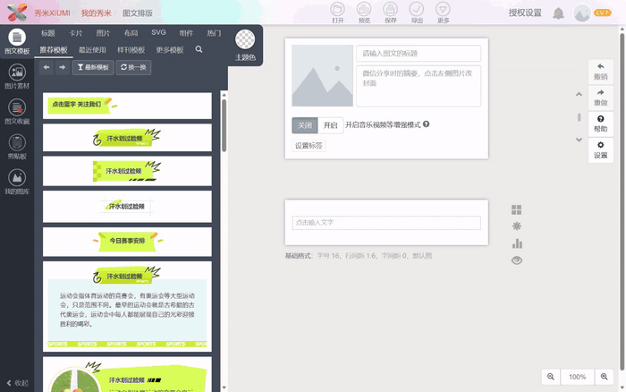

# 牵引秀米导入器

通稿一键排进秀米。素材 → 排版 → **自动写进你的编辑器**，不用复制粘贴。

素材 → 排版 HTML → **自动写进你的秀米编辑器**。



不用复制粘贴 HTML，不用手动调样式，不用装插件。AI 把整篇排版（含图片）一次性灌进秀米正文区，
你在编辑器里看一眼，点保存就完事。

### 👉 [先看效果](https://cerry3184-spec.github.io/qianyin-xiumi/)

---

## 整个流程

```
你把素材丢给 AI（Word / 微信记录 / 手写稿照片都行）
        │
        ▼
   AI 整理成结构化内容
        │
        ▼
   生成排版 HTML（25+ 内联样式组件，图片已内嵌）
        │
        ▼   ← 这一步是本项目的重点
   自动注入秀米编辑器：标题填好、正文写入、图片就位
        │
        ▼
   你在编辑器里看一眼 ──► 自己点保存 ──► 群发
```

**关键在第 4 步。** 大多数排版工具到「生成 HTML」就结束了，剩下粘进编辑器、处理样式丢失、
重新传图这些活还得你自己干。这里直接写进编辑器，省掉整个搬运过程。

## 和「自己复制粘贴 HTML」的差别

| | 手动复制粘贴 | 这个工具 |
|---|---|---|
| 标题 | 手动填 | 从内容自动带过去 |
| 正文样式 | 粘贴后可能被编辑器改写 | 内联样式直接写入，不改写 |
| 图片 | 常常丢，要重新上传 | base64 内嵌，跟着一起进去 |
| 操作 | 开文件、全选、复制、切换窗口、粘贴 | 一条命令，或让 AI 做 |
| 出错 | 粘漏了一段自己都不知道 | 注入前先 `--check`，缺什么先报出来 |

## 用户怎么用

复制本页地址，发到你的 AI 对话里（WorkBuddy / ChatGPT / Claude 都行），附上这句：

> 帮我装一下这个仓库，然后做一篇公众号推文，做完直接放进秀米。
> 主题是【XX 社区重阳节敬老活动】，给【社区老人】看。
> 素材我发你：时间、地点、参加人员、活动内容。

AI 会自己下载、装环境、问你剩下的信息、生成排版、**然后直接注入你的秀米编辑器**。

你要做的只有三件事：**提供素材、看效果提意见、自己点保存**。

---

## 它长什么样

仓库里有两份填满的示例，clone 下来直接双击就能看：

| 文件 | 题材 | 特点 |
|---|---|---|
| `示例-年度表彰大会.html` | 学校/单位年度表彰 | 标准官方通稿，14px 正文 |
| `示例-养老服务驿站.html` | 街道社区养老服务 | 中老年受众，**字号放大 1.2 倍** |

配色来自高校官方公众号的实测：深红 `#B51011` + 米杏 `#F5DDC9` 点线卡片。

---
---

# 🤖 给 AI Agent 的操作手册

> **本节是写给 AI 的。** 当用户把本仓库链接发给你，请按下面执行。
> 如果用户只是闲聊，忽略本节。

## 你的任务

把用户的文字素材变成排版，**直接注入用户的秀米编辑器**，然后交给用户自己保存。

⚠️ **生成 HTML 不算完成任务。** 用户要的是「内容已经在秀米里了」，
不是「我给你一个 HTML 文件」。必须走到第 5 步注入，除非用户明确说只要文件。

## 第 0 步：先问清这四件事

不要直接开写。先确认：

| 要问什么 | 为什么 |
|---|---|
| 给谁看 | 决定字号（`font_scale`）和语气 |
| 什么题材 | 决定用哪套块组合 |
| 谁出席、时间地点 | 通稿必备，缺了会被领导打回 |
| 有没有名单 / 照片 | 名单要按姓氏笔画排，照片要确认路径 |

素材是 Word、微信记录、手写稿照片都可以，让用户直接粘贴或给路径。

## 第 1 步：安装

```bash
git clone https://github.com/cerry3184-spec/qianyin-xiumi.git
cd qianyin-xiumi
pip install playwright
```

**不要执行 `playwright install chromium`。** 本工具用 `channel="msedge"` 借系统 Edge，
下载 Chromium 慢且没必要。Windows 自带 Edge，直接可用。

## 第 2 步：验证环境

```bash
python build_gonggao.py --check
```

正常输出应包含：

```
[待填] 无，内容已填完 ✓
[图片] 全部存在 ✓
```

如果不通过，先修环境，不要往下走。

## 第 3 步：生成用户的稿子

**复制示例改，不要从零写 JSON。**

```bash
# 复制一份
cp 示例-养老服务驿站.json 稿件.json
# 改内容（用编辑器替换字段值，保持结构不变）
# 生成
python build_gonggao.py --data 稿件.json --out 稿件.html
```

全程只改 JSON 里的值，不要动键名。带 `_` 开头的键是注释，不会渲染。

生成后打开 `稿件.html` 看效果，或者按第 4 步注入秀米。

## 第 4 步：检查（每次生成后必须做）

```bash
python build_gonggao.py --data 稿件.json --check
```

两个指标必须都干净：

- `[待填] 无` —— 否则说明有 `【XX】` 占位没替换
- `[图片] 全部存在` —— 否则图片路径写错了，会渲染成灰框

**不要跳过这一步。** 用户看不出来哪里缺，你要替他指出。

## 第 5 步：注入秀米（本项目的核心动作）

注入会做三件事，一次性完成：

1. 打开秀米编辑器新建图文
2. **把标题填进标题栏**
3. **把整篇排版写进正文区**——包括图片（已 base64 内嵌，不需要重新上传）

用户在浏览器窗口里看到的就是最终效果，不需要再做任何搬运。

### 5.1 首次使用：采集登录态

```bash
python tools/collect_login.py --timeout 900
```

会弹出 Edge，让用户**扫码登录秀米**。脚本全程等 `/api/user/info` 返回 200，成功后自动保存到 `xiumi_auth.json`。

⚠️ 登录态约 **8 天**过期。如果注入时报 401 或「未登录」，重跑这条命令即可，不用纠结 Cookie 数量。

### 5.2 演练注入（默认动作）

```bash
python build_gonggao.py --data 稿件.json --out 稿件.html --inject
```

- 注入后浏览器保持打开 **180 秒**（`--keep 300` 可延长）
- **不保存**，用户关掉就没了
- 让用户在这 180 秒里确认排版

### 5.3 保存（只有用户明确要求时）

```bash
python build_gonggao.py --data 稿件.json --out 稿件.html --inject --save
```

会真的在用户秀米账号里创建一篇图文。**用户没开口就不要执行。**

### 注入失败了怎么排查

| 报错 | 原因 | 处理 |
|---|---|---|
| `/api/user/info` 401 | 登录态过期 | 重跑 5.1 |
| 找不到标题输入框 | 秀米改版了 | 告知用户，不要硬试 |
| HTML 已注入但排版散架 | 内容有结构错误 | 检查是否 `<p>` 里嵌了块级元素 |
| 保存失败 | 登录态失效 | 重跑 5.1 后重试 |

---

## 硬性规则（必须遵守）

1. **不要替用户点保存。** 保存和发布是用户自己的动作。默认只做 `--inject`（演练）。
2. **不要编造数据、人名、政策条款。** 数字必须来自用户提供的材料。政策类内容（金额、年龄门槛、期限）写错就是事故。
3. **中老年受众必须放大字号。** 见下表，不要沿用默认 14px。
4. **名单不要自己排。** 让用户确认顺序；个人名单按姓氏笔画，集体名单写「排名不分先后」。
5. **生成后必须跑 `--check`**，并且把两个指标的结果告诉用户。
6. **图片路径必须是用户真实存在的文件。** 找不到就明确告诉用户，不要静默跳过。

## 受众与字号

在 JSON 里写 `"font_scale": 1.2` 即可全局放大，不用逐处改组件。

| 受众 | font_scale | 正文实际字号 |
|---|---|---|
| 学生、年轻职场 | 不写（默认） | 14px |
| 混合人群、家长 | `1.1` | 15.4px |
| **中老年、社区居民** | `1.2` | 16.8px |
| 纯老年读者、大字号版 | `1.3` | 18.2px |

中老年稿额外三条：

- 段落不超过 3 行，一句说一件事
- 「时间、地点、多少钱、怎么办、问谁」五项必须用 `kv` 或 `highlight` 单独拎出来
- 不用英文副标题、不用缩写、不堆四字格

## 能生成什么（内容块 API）

`sections[].blocks` 和 `tail_blocks` 里放这些对象，按数组顺序渲染：

| type | 效果 | 必填字段 |
|---|---|---|
| `p` | 正文段落（首行缩进） | `text` |
| `quote` | 金句引文块（左侧竖线 + 出处） | `text`, `source` |
| `highlight` | 荧光底色重点段 | `text`, `label` |
| `bar` | 红底白字小标题条 | `text` |
| `points` | 带序号的重点列表 | `items`（字符串数组） |
| `stats` | 大数字亮点条 | `items: [[数字, 说明], ...]` |
| `table` | 正式表格 | `header`, `rows`, `widths` |
| `kv` | 左标签右内容信息表 | `pairs: [[标签, 内容], ...]` |
| `image` | 通栏大图 + 图注 | `caption`, `img` |
| `photos` | 多图网格 | `captions`, `imgs`, `per_row` |
| `names` | 名单卡片 | `title`, `names`, `sort` |
| `tags` | 标签块行 | `items` |
| `badge` | 斜角徽标 | `text` |
| `divider` / `wave` | 分隔线 / 波浪线 | — |

页面级的键：

```
title / header_img / badge / tags / stats / paragraphs
sections / name_groups / tail_blocks / ending / closing
font_scale / footer_qr / editor / first / second / third
```

渲染顺序固定：标题 → 徽标 → 标签 → 数据条 → 正文 → 章节 → 名单 → 结尾 → 尾块 → 金句 → 落款 → 署名。

## 常见故障

| 现象 | 原因与处理 |
|---|---|
| 注入报「未登录」或 `/api/user/info` 401 | 登录态过期（约 8 天）。重跑 `tools/collect_login.py` |
| 中文全乱码 | 用 bat 时别在 PowerShell 里调；脚本要求 GBK 环境（bat 内已处理） |
| `[WARN] 属性引号未闭合` | 生成器自身 bug，把提示的片段反馈给维护者 |
| 名单只显示一半 | 同上的结构错误，检查是否有 `<p>` 里嵌了块级元素 |
| HTML 体积暴涨 | 本地图片会转 base64，3 张约 100KB。图片多于 5 张先传秀米图库换 CDN 地址 |

## 目录

```
qianyin-xiumi/
├── build_gonggao.py          排版引擎（25+ 组件）
├── 示例-年度表彰大会.json/.html
├── 示例-养老服务驿站.json/.html
├── gonggao_data.json         当前稿件（.gitignore 排除）
├── images/                   配图
├── tools/                    秀米注入（来自 gzh-content-skill，MIT）
│   ├── collect_login.py      采集登录态
│   ├── xiumi_auto.py         注入编辑器
│   ├── upload_images.py      传到秀米图库换 CDN
│   └── browser_cfg.py        Edge 启动配置
├── 0-从这里开始.md            给零基础用户的引导
├── 0-先读我.md                字段与组件参考
└── *.bat                     一键脚本（Windows）
```

## 许可

本仓库代码 MIT。

`tools/` 下的秀米自动化脚本来自 [gzh-content-skill](https://github.com/songlitong521-oss/gzh-content-skill)（MIT），已做本地化修改，许可证见 `tools/LICENSE-gzh-content-skill`。

`.gitignore` 已排除 `xiumi_auth.json`（秀米登录凭证）——**永远不要提交这个文件**。
